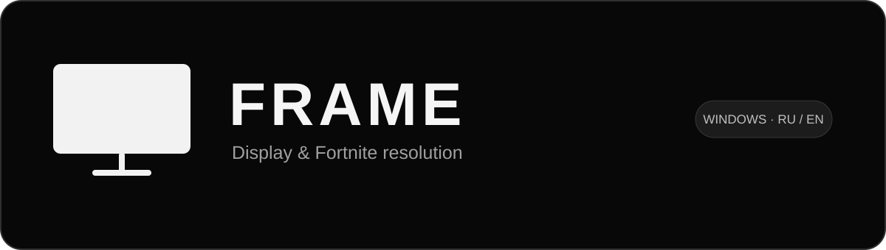

  

<b>Разрешение экрана и Fortnite в одном окне.</b> Display and Fortnite resolution in one place.

  <a href="https://github.com/veltrix231/frame/releases/latest/download/FRAME-portable.zip"><b>⬇ Скачать FRAME для Windows / Download for Windows</b></a>
    
  <a href="https://github.com/veltrix231/frame/releases">Версии / Releases</a> ·
  <a href="https://www.tiktok.com/@lyorefreak">TikTok @lyorefreak</a>

---

## Русский

**FRAME** — бесплатная программа для выбора разрешения и частоты рабочего стола, а также записи разрешения в конфиг Fortnite. Чёрный интерфейс, белый предпросмотр монитора и переключение RU / EN.

### Скачать и запустить

1. [Скачай FRAME-portable.zip](https://github.com/veltrix231/frame/releases/latest/download/FRAME-portable.zip).
2. Распакуй архив в любую папку.
3. Запусти **ResolutionPicker.exe**. Установка не требуется.

В архиве находятся программа и инструкция. Версия **1.0.1**. Для Windows; пользовательские режимы NVIDIA требуют установленного драйвера и панели управления NVIDIA.

### Что умеет FRAME

- Выбирать монитор, разрешение и частоту из доступных режимов.
- Применять режим рабочего стола с подтверждением: без него старый режим возвращается через 15 секунд.
- Автоматически находить `GameUserSettings.ini` Fortnite или запоминать выбранный вручную файл.
- Отдельно записывать выбранное разрешение в конфиг Fortnite и включать для файла «Только чтение» после записи.
- Показывать сохранённые в драйвере кастомные разрешения NVIDIA, открывать создание режима и обновлять список после его сохранения.
- Показывать пропорции выбранного разрешения и инструкцию по масштабированию во вкладке FAQ.
- Переключать русский и английский язык с сохранением выбора.

### Как пользоваться

Выбери конфиг, монитор и режим. **«Применить режим»** меняет рабочий стол. **«Записать разрешение в Fortnite»** обновляет конфиг отдельно — перед записью закрой игру.

Чтобы добавить пользовательский режим: **«Кастомное разрешение» → «Создать в NVIDIA»**, создай и сохрани его в панели NVIDIA, затем вернись в FRAME и нажми **«Обновить»**.

Для растянутого изображения без полос включи в панели NVIDIA: **Дисплей → Регулировка размера и положения рабочего стола → Масштабирование → Во весь экран → Применить**. Эта инструкция есть и в FAQ программы.

При записи в Fortnite верхние четыре значения разрешения получают выбранную ширину и высоту. Нижние четыре значения `DesiredScreenWidth/Height` и `LastUserConfirmedDesiredScreenWidth/Height` всегда устанавливаются в **1920 × 1080**. Остальные параметры сохраняются. Резервные копии не создаются; результат записи проверяется чтением файла.

---

## English

**FRAME** is a free Windows app for choosing desktop resolution and refresh rate and saving resolution settings to Fortnite. It features a black interface, a white monitor preview and a persistent RU / EN language switch.

### Download and run

1. [Download FRAME-portable.zip](https://github.com/veltrix231/frame/releases/latest/download/FRAME-portable.zip).
2. Extract the archive into any folder.
3. Run **ResolutionPicker.exe**. No installation is needed.

The archive contains the app and instructions. Version **1.0.1**. NVIDIA custom modes require an installed NVIDIA driver and NVIDIA Control Panel.

### Features

- Choose a display, resolution and refresh rate from available modes.
- Apply a desktop mode with a 15-second confirmation and automatic rollback.
- Detect Fortnite's `GameUserSettings.ini` automatically or remember a manually selected file.
- Save the resolution to Fortnite separately and enable the file's Read-only attribute after saving.
- List saved NVIDIA custom modes, open custom resolution creation and refresh the list after saving in NVIDIA.
- Preview the selected aspect ratio and find Full-screen scaling instructions in FAQ.
- Switch between English and Russian without restarting.

### Quick start

Choose your config, display and mode. **Apply display mode** changes the desktop. **Save resolution to Fortnite** updates the config separately; close the game first.

For a new custom mode, open **Custom resolution → Create in NVIDIA**, create and save the mode in NVIDIA Control Panel, then return to FRAME and click **Refresh**.

For a stretched image without side bars: **NVIDIA Control Panel → Display → Adjust desktop size and position → Scaling → Full-screen → Apply**.

When saving to Fortnite, the upper four resolution entries use your selected width and height. The lower four `DesiredScreenWidth/Height` and `LastUserConfirmedDesiredScreenWidth/Height` entries stay at **1920 × 1080**. Other settings are preserved. No backups are created; the written file is read back for verification.

---

[SHA-256 archive checksum](downloads/SHA256SUMS.txt) · [TikTok @lyorefreak](https://www.tiktok.com/@lyorefreak)
